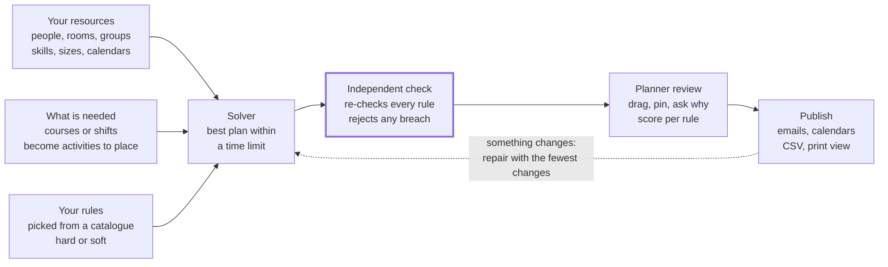

# Cartlyf

Cartlyf builds schedules automatically: university timetables, hospital rosters, any plan that puts
people, rooms and equipment on a calendar. It works from an organisation's own resources and rules,
and checks every schedule against those rules before anyone sees it.

One configurable product serves every organisation. A customer's policies ("at most 2 sessions a
day", "11 hours' rest between shifts") are configuration, never code.

> **Status:** v1 is feature-complete and in acceptance (Phase 09). Every automated acceptance test
> passes; staging deployment, the restore drill and the load test are pending.

## How it works



The solver proposes a plan, and a separate checker must confirm it breaks no hard rule before a
planner ever sees it. After publishing, any change goes back through a repair that keeps the rest
of the plan.

## The building blocks

| Idea | What it means | University example | Hospital example |
| --- | --- | --- | --- |
| **Resources** | The people, places, equipment and groups that get booked, with tags (skills), a size or capacity, and an availability calendar | Lecturers tagged with their subjects; rooms with seat counts; student groups with headcounts | Nurses tagged RN, midwife or ICU, with contracted hours |
| **Demands** | What needs scheduling; each demand becomes activities to place | "Data Structures: 2 sessions of 2 hours a week for BIT1 and BCS1" | "Every day, Ward A needs 3 RNs and 1 midwife on the Day shift" |
| **Rules** | Limits and preferences from a catalogue, set as *hard* (must hold) or *soft* (avoid, with a weight) | At most 2 sessions a day per lecturer; rooms must seat the whole class | At least 11 hours' rest between shifts; at most 3 nights in a row |
| **Schedule** | One planning problem: a date range, a time zone, its demands and rules | "Term 1 2026" | "Ward A + B, January 2027" |
| **Versions** | Each solve makes a draft; publishing locks it; edits make a new draft | Draft 3 published as the term timetable | A sick-call repair published as version 2 |

Industry templates (**Education** and **Healthcare** in v1) set up resource types, time slots and a
default rule set in one click; every value stays editable.

## Features

| Feature | What it does |
| --- | --- |
| **Automatic solving** | Google OR-Tools CP-SAT searches for the best plan that obeys every hard rule, in the background, with a time limit, live progress and cancel |
| **Independent checker** | A separate program re-checks every result; nothing that breaks a hard rule is saved, shown or published |
| **Score breakdown** | Shows what each soft rule cost in the final plan |
| **No-code rule builder** | 14 rule templates filled in with forms: who it applies to, the limit, hard or soft |
| **Planner board** | People-by-time grid with drag-and-drop, live green/red validation with the reason, pins, keyboard support |
| **Explanations** | "Why is this here?", "Why can't it go there?", and "Why is this impossible?" with the rules to relax |
| **Minimal-change repair** | Re-plans after a sick call or closure, freezes the past, and shows a diff before publishing |
| **Fairness ledger** | Balances nights and weekends across people, counting previous rosters |
| **Versions and publishing** | Draft, published, archived; a diff between any two versions |
| **Notifications and calendars** | Emails people a published change (with automatic re-sending if delivery fails); personal iCal feeds |
| **Exports and reports** | CSV, print view; utilisation, load per person, coverage gaps, fairness spread |
| **CSV import** | Column mapping, a dry run listing every bad row, all-or-nothing import, pre-solve feasibility check |
| **Roles** | Org admin, planner, member, viewer; one person can hold several |

### Rule catalogue

Always on: no double-booking, nobody scheduled while unavailable, every slot filled with someone
qualified, pins respected.

| Rule | In plain words |
| --- | --- |
| Room fits the class (`capacity_fit`) | The room seats everyone assigned to it |
| Maximum load (`max_load`) | At most so many sessions or hours per day, week or schedule, optionally within a time window |
| Minimum load (`min_load`) | At least so many hours, such as contracted hours |
| Minimum rest (`min_rest`) | A minimum gap between someone's consecutive assignments |
| Maximum in a row (`max_consecutive`) | Limits consecutive days, or consecutive shifts of a kind such as nights |
| Spread (`spread`) | Sessions of the same course spread out, e.g. never twice a day |
| Same time (`same_time`) | Linked activities start together |
| Order (`precedence`) | One activity ends before another starts, with a gap |
| Preferences (`preference`) | Reward preferred times, avoid disliked ones, per person |
| Fewer gaps (`minimize_gaps`) | Avoid idle hours between someone's sessions in a day |
| Balance (`balance`) | Share the workload evenly |
| Fairness over time (`fairness`) | Share nights and weekends evenly, counting history |
| Even weekdays (`day_distribution`) | Spread a group's sessions across the week |
| Stability (`stability`) | Penalise changes to the published plan (used by repair) |

## Trust and data

- **Tenant isolation.** Organisations share the platform, not their data. PostgreSQL row-level
  security (enabled and forced) refuses one organisation's rows to another, even if application
  code had a bug. The app connects as a non-superuser role without `BYPASSRLS`, and an isolation
  test tries every endpoint across two organisations on every push.
- **Verified schedules.** Solver and checker are separate implementations of each rule; if they
  disagree, the result is discarded and an alert is raised.
- **Accounts.** argon2id password hashes, rate-limited sign-in, 15-minute access tokens with
  rotating refresh tokens.
- **Hosting (v1).** Render in Frankfurt (API, worker, Postgres 16 with daily backups and
  point-in-time recovery, Key Value) and Cloudflare Pages for the web app. Errors go to Sentry
  with personal data stripped.

## Repository layout

```
apps/api/         FastAPI app + Dramatiq worker (package cartlyf_api), Alembic migrations, DB roles
apps/web/         React 18 + TypeScript + Vite SPA (Tailwind, shadcn/ui, TanStack Query, orval client)
packages/engine/  Pure scheduling engine (package cartlyf_engine): no DB, network, clock or env access
tools/            Smoke test, Render deploy helper, demo seeding, load test, ISBAT benchmark report
render.yaml       Render blueprint (staging and production)
```

The Education template is benchmarked against the university's former timetabling system: its data
lives as versioned fixtures in `packages/engine/tests/fixtures/isbat/`.

## Prerequisites

- [uv](https://docs.astral.sh/uv/) (manages Python 3.12 and the workspace)
- Node.js 24 (see `.nvmrc`) and [pnpm](https://pnpm.io/)
- Docker (for Postgres 16, Redis 7 and MinIO locally, and for the test suite)

## Run locally

```sh
cp .env.example .env          # then change the passwords; change the ports if 5432/6379 are taken
docker compose up -d --wait   # Postgres 16 (cartlyf_owner / cartlyf_app roles), Redis 7, MinIO (S3 API) + bucket
uv sync
uv run --env-file .env alembic -c apps/api/alembic.ini upgrade head
```

API and worker (separate terminals):

```sh
uv run --env-file .env uvicorn cartlyf_api.main:create_app --factory --reload
uv run --env-file .env dramatiq cartlyf_api.jobs.worker
```

Web app at http://localhost:5173 (proxies `/api` to the API on port 8000):

```sh
cd apps/web
pnpm install
pnpm api:generate   # exports the OpenAPI schema from the API and generates the typed client
pnpm dev
```

Locally, emails are not sent: they are written to the API's log (sign-up confirmation links
included). To load demo organisations (the ISBAT university term and a 40-nurse hospital roster):

```sh
uv run --env-file .env python tools/seed_demo.py ~/cartlyf-demo-accounts.json
```

The accounts file holds the generated logins; keep it out of the repo.

`GET /api/v1/health` reports the database role the API connected as. It returns 503 if that role is
a superuser or has `BYPASSRLS`, because row-level security is the tenant boundary. See
`apps/api/db/README.md` for the two database roles.

## Checks

```sh
uv run ruff check . && uv run ruff format --check . && uv run pyright && uv run lint-imports
uv run pytest                     # integration tests start Postgres/Redis/MinIO with Testcontainers

cd apps/web
pnpm lint && pnpm format:check && pnpm typecheck && pnpm test && pnpm build
pnpm e2e                          # Playwright; needs the worker running
```

CI (`.github/workflows/ci.yml`) runs the same checks plus gitleaks, `pip-audit` and `pnpm audit`,
then deploys `Development` to staging and `main` to production (after a reviewer approves).

## Not in v1

Staff self-service (availability entry, shift swaps), SMS/WhatsApp, two-way calendar sync, a native
mobile app, further industry templates, forecasting and payroll links, SSO, public API keys and
billing are on the roadmap, not built.
